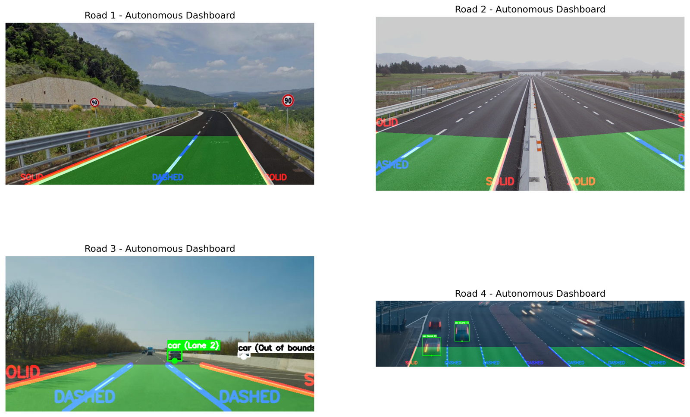
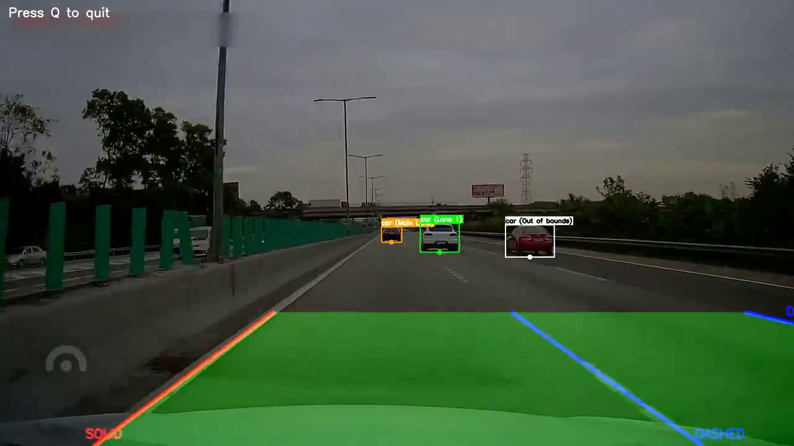
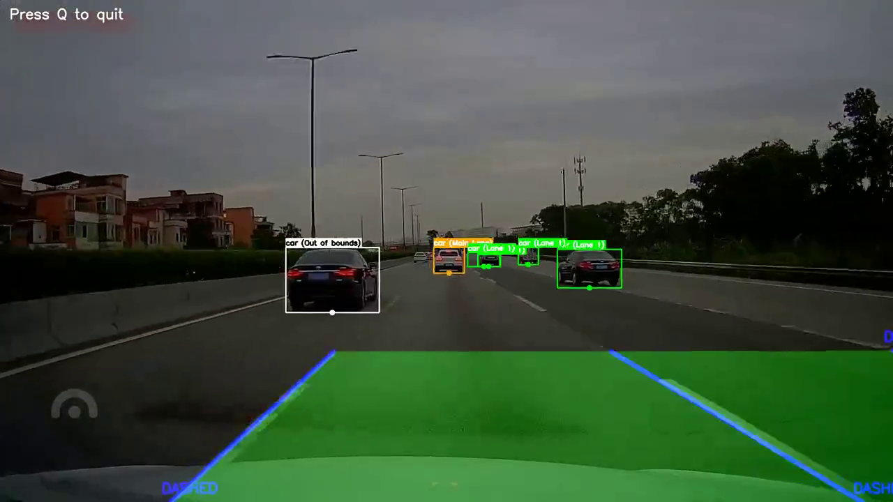
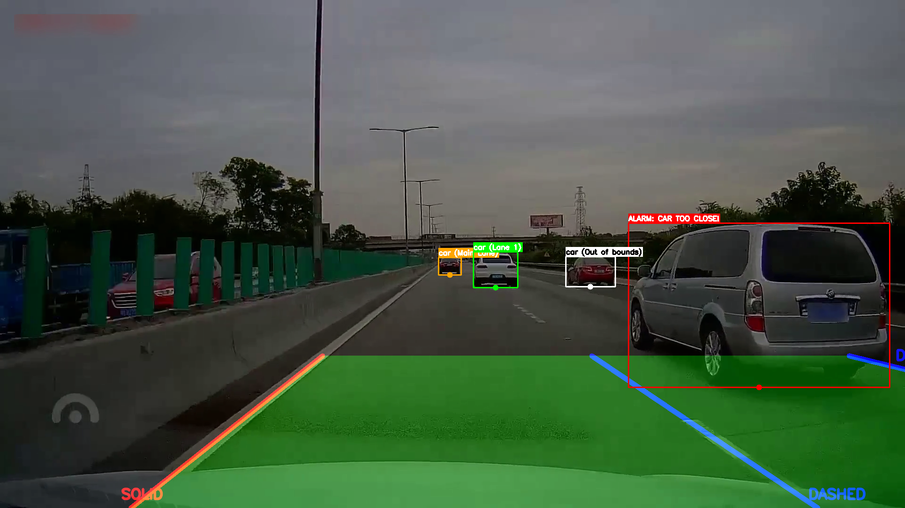
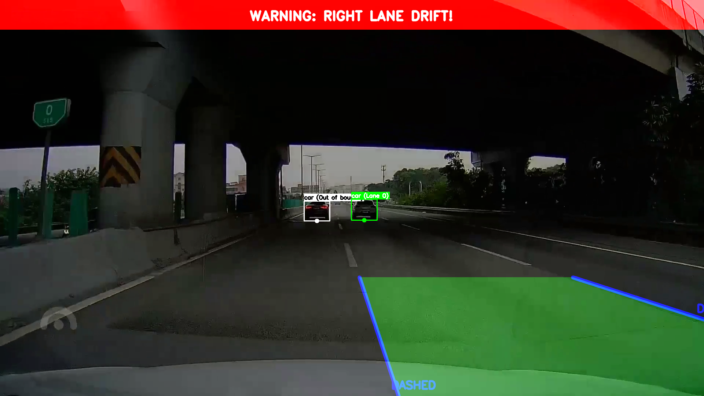
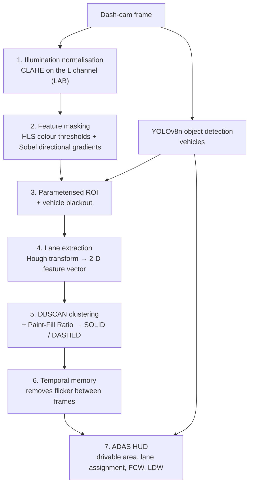

# Vision-Based ADAS Dashboard — Classical Computer Vision vs. Hybrid Deep Learning

Course project for **Computer Vision** (M.Sc. Control Systems Engineering, University of Padova,
Prof. Pietro Zanuttigh, academic year 2025–2026). Grade: **30/30**.

A working driver-assistance pipeline that processes real dash-cam footage and overlays an ADAS dashboard on it:
lane boundaries, solid/dashed lane classification, drivable area, surrounding-vehicle detection with lane
assignment, **Forward Collision Warning (FCW)** and **Lane Departure Warning (LDW)**.

**One-page project overview (PDF): [`docs/project-overview.pdf`](docs/project-overview.pdf)** ·
**Full report (PDF): [`report/Vision-Based-ADAS-Dashboard-report.pdf`](report/Vision-Based-ADAS-Dashboard-report.pdf)**

---

## Results



*Four scenarios: green = validated drivable area, orange/blue lane overlays with SOLID / DASHED classification,
boxes = detected vehicles labelled with their assigned lane.*

| Frame from the demo video | What it shows |
|---|---|
|  | solid (orange) and dashed (blue) lane classification, `car (Main Lane)`, `car (Lane 1)`, `car (Out of bounds)` |
|  | several vehicles assigned to lanes, including one outside the host lane (`Out of bounds`) |
|   | FCW triggered by Y-axis proximity · LDW triggered by lateral drift toward the right boundary |

**Demo video:** [`media/adas-dashboard-demo-720p.mp4`](media/adas-dashboard-demo-720p.mp4)

## Design philosophy

End-to-end learned models (e.g. LaneNet) dominate real ADAS products, but a black box hides the fundamentals.
This project therefore uses a **hybrid architecture**: YOLO handles object detection — where deep learning genuinely
excels — while everything related to lane extraction (colour filtering, edge gradients, geometric clustering,
temporal tracking) is built from classical computer-vision primitives.



### Pipeline stages

| # | Stage | Implementation |
|---|---|---|
| 1 | Illumination normalisation | CLAHE (`clipLimit=2.5`, `tileGridSize=(8,8)`) applied to the L channel in LAB, correcting harsh shadows before thresholding |
| 2 | Feature masking | Adaptive HLS colour masks (white + widened yellow range) **fused** with directional edge gradients — Sobel chosen over Canny because lane edges have a known orientation |
| 3 | ROI & vehicle blackout | Parameterised triangular ROI fitted to the camera geometry; detected vehicles are blacked out so their edges cannot contaminate lane fitting |
| 4 | Geometric lane extraction | Hough transform → each line mapped to a compact 2-D feature vector |
| 5 | Lane classification | DBSCAN clustering on the feature space; the **Paint-Fill Ratio** of a line (> 85 % filled ⇒ *SOLID*, otherwise *DASHED*) classifies the marking |
| 6 | Temporal memory | Tracked lane estimates are carried across frames to resolve flickering |
| 7 | ADAS HUD | Drivable-area polygon with asphalt validation, forward collision warning from Y-axis proximity, lane departure warning from lateral drift |

## Repository contents

| Path | Content |
|---|---|
| `notebook/FinalProject.ipynb` | The full project notebook with executed outputs (`Setup & Initialization` → `Image Pre-processing` → `ROI & Masking` → `Feature Extraction` → `Clustering & Tracking` → `Visualization` → `Final Testing` → `Final Video Output`) |
| `src/project.py` | The pipeline as an importable, documented module (`enhance_road_features`, `create_robust_mask`, lane fitting, ADAS HUD) |
| `src/Exploration.ipynb` | Earlier exploratory notebook |
| `report/` | LaTeX source (`main.tex`), the figures used in the report, and the compiled report PDF |
| `data/roads/` | Test images (`road1`…`road10`) and a 720p test video |
| `media/` | 720p demo of the dashboard running on the test video |
| `results/`, `docs/` | Result figure, extracted frames, one-page project overview |

## How to run

```bash
pip install -r requirements.txt          # opencv-python, numpy, scikit-learn, ultralytics, matplotlib
jupyter notebook notebook/FinalProject.ipynb
```

`ultralytics` downloads the `yolov8n` weights automatically on first use (weights are not committed).
The video windows close with `q`.

## Evaluation, limitations and what I took away

* Estimated **≈75 % reliability** on reasonable road conditions — the lane overlay and the ADAS alerts behave
  correctly on the majority of frames.
* **Speed** is the main bottleneck: YOLOv8n inference plus the classical chain (CLAHE → Hough → DBSCAN) in Python
  would need multithreading or a lower-overhead language for real deployment.
* **Curvature**: the lane model is linear ($y = mx + b$), so sharp bends need a polynomial fit instead.
* The exercise makes concrete why industry converged on semantic segmentation for lane extraction: a trained model
  needs no ROI tuning, does not break on shadows and handles curves natively — exactly the problems this pipeline had
  to work around explicitly.

## Skills demonstrated

`Computer vision` · `OpenCV` · `NumPy` · `scikit-learn (DBSCAN)` · `Ultralytics YOLOv8 object detection` ·
`Image pre-processing (CLAHE, colour spaces, thresholding)` · `Edge and gradient features (Sobel/Hough)` ·
`Clustering-based geometry fitting` · `Temporal filtering/tracking` · `Driver-assistance systems (FCW, LDW)` ·
`Scientific reporting in LaTeX (report + figures)`

## Context and licence

Project carried out individually for the Computer Vision course at the University of Padova (A.Y. 2025–2026,
Prof. P. Zanuttigh); the course handout is not redistributed. Test images and footage are the material used for the
course project, kept here as reproducibility inputs. Code released under the [MIT licence](LICENSE); the report text
and figures are © Kiavash Rabbani Soudabi.
